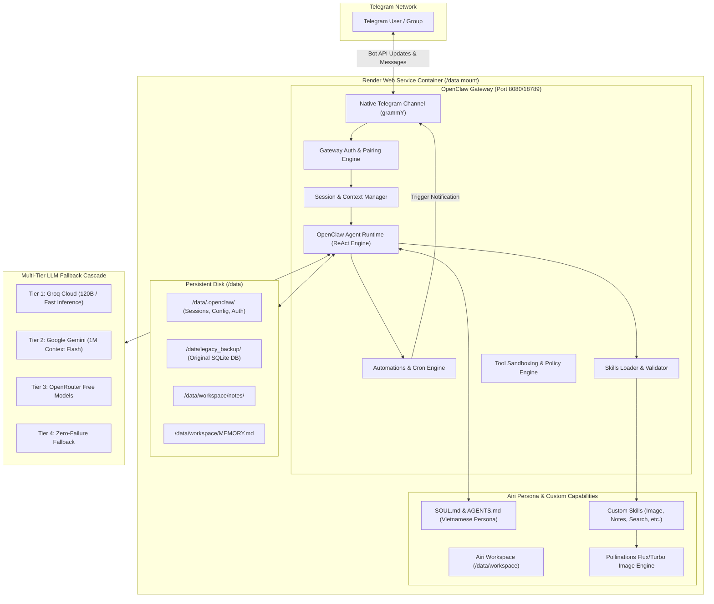

# Airi Sensei v3.0 Architecture Specification

## 1. Executive Summary

Airi Sensei version 3.0 represents a generational architectural upgrade from the custom Python ReAct bot (v2.5) to an enterprise-grade agent architecture powered by **OpenClaw** as the primary Agent Runtime, with **Airi** operating as the personalized assistant and persona layer.



---

## 2. Architectural Comparison: v2.5 vs. v3.0

| Domain | Airi Sensei v2.5 (Legacy) | Airi Sensei v3.0 (Target) |
|---|---|---|
| **Primary Runtime** | Custom Python async application (`app/main.py`) | OpenClaw Gateway Daemon |
| **Telegram Driver** | `python-telegram-bot` v21 long-polling | OpenClaw Native Telegram Channel (grammY) |
| **Agent Execution Loop** | Custom ReAct loop in `app/agent/agent.py` | OpenClaw Native Autonomous Agent Runtime |
| **Tool Calling Engine** | Manual OpenAI function calling schema mapping | Native OpenClaw Tool Invocation & Validation |
| **Skill Extensibility** | Hardcoded Python functions in `app/agent/tools.py` | Modular OpenClaw Skills (`SKILL.md` manifests) |
| **Context Memory** | SQLite `messages` table with fixed limit (14 items) | Native OpenClaw Session Context + sliding windows |
| **User Facts & Profile** | SQLite `user_facts` table injected via prompt string | OpenClaw `MEMORY.md` + Dynamic User Profiles |
| **Notes Management** | SQLite `notes` table manipulated via custom tool | File-backed Workspace Notes (`workspace/notes/`) |
| **Scheduled Reminders** | Custom `reminder_worker.py` polling SQLite every 15s | OpenClaw Native Automations / Cron Scheduler |
| **Image Generation** | Python `aiohttp` script to Pollinations API | Dedicated `airi-image` Skill with Python/CLI runner |
| **HTTP Health Server** | Custom `aiohttp` web server on port 8080 | OpenClaw Gateway `/health` & HTTP control plane |
| **Access Control** | In-memory `AuthService` with runtime passcode | OpenClaw DM Pairing & Strict Owner ID Whitelisting |

---

## 3. Core OpenClaw Responsibilities

Under the v3.0 architecture, OpenClaw owns all foundational infrastructure responsibilities:
1. **Telegram Channel Connectivity:** Manages single-owner long-polling connection with Telegram Bot API without polling conflicts.
2. **Session Lifecycle:** Tracks user dialogues, topic isolation, message threading, and token budgeting.
3. **Agent Runtime:** Drives the ReAct thought-action-observation cycle with robust error recovery.
4. **Tool Sandboxing:** Governs filesystem access (locked to `/data/workspace`), network egress, and command policies.
5. **Skill Discovery:** Discovers and validates skills from `<workspace>/skills/` on demand.
6. **Native Scheduling:** Executes reminders and cron triggers with high reliability without custom worker polling loops.
7. **Gateway Authentication:** Protects all HTTP and WebSocket endpoints with bearer token authorization (`OPENCLAW_GATEWAY_TOKEN`).

---

## 4. Airi Personality Layer Responsibilities

Airi provides the domain-specific personality and capabilities on top of the runtime:
1. **Persona & Soul (`SOUL.md`, `AGENTS.md`):** Defines Airi Sensei as a smart, charming, empathetic companion with flexible user-directed honorifics (`anh yêu`, `chồng`, `sếp`).
2. **Vietnamese Language Fluency:** Enforces natural Vietnamese syntax, expressive emotion, and clean markdown presentation.
3. **Strict Truthfulness Policy:** Enforces factual accuracy; requires multi-step research (search + deep webpage extraction) before asserting live data (oil prices, gold rates, exchange rates).
4. **Art Generation (`skills/airi-image/`):** Manages prompt translation (Vietnamese -> English) and generates 1024x1024 artwork via Pollinations Flux/Turbo.
5. **Data Compatibility & Migration:** Ingests legacy user facts, notes, and reminders into OpenClaw's native representations without data loss.

---

## 5. Process & Concurrency Model

### 5.1 Single-Owner Rule (No Polling Contention)
> [!CRITICAL]
> Only one process may consume updates from the Telegram Bot API token at any given moment.

- **V2.5 Legacy Python bot polling is completely decommissioned** in production.
- OpenClaw Gateway is the **exclusive** consumer of Telegram updates.
- Migration and backup scripts operate strictly offline or as one-off CLI utilities; they never initialize Telegram long-polling.

### 5.2 Process Supervision on Render
- Render executes the OpenClaw Gateway container as a single Web Service instance.
- Port binding respects Render's dynamic `$PORT` environment variable (default `8080`).
- Health check requests hitting `/health` receive an immediate HTTP 200 response, enabling seamless zero-downtime rolling deploys.
- Graceful shutdown handles `SIGTERM` and `SIGINT`, flushing active session states to `/data/.openclaw/` before container exit.

---

## 6. Storage & Directory Hierarchy

All stateful data is anchored to the persistent disk mounted at `/data`:

```
/data/
├── .openclaw/                    <-- OpenClaw Global State
│   ├── openclaw.json             <-- Runtime configuration (JSON5)
│   ├── sessions/                 <-- Conversation SQLite databases & cache
│   └── automations/              <-- Scheduled cron jobs & reminders
├── workspace/                    <-- Airi Assistant Workspace
│   ├── AGENTS.md                 <-- Core operational directives & policies
│   ├── SOUL.md                   <-- Persona, tone, honorifics, style
│   ├── USER.md                   <-- User configuration & profile preferences
│   ├── TOOLS.md                  <-- Local tool usage guide & constraints
│   ├── MEMORY.md                 <-- Curated persistent long-term memory
│   ├── notes/                    <-- Markdown-based personal notes
│   │   └── user_<user_id>/       <-- Per-user note files
│   └── skills/                   <-- Custom Airi skills
│       ├── airi-image/
│       ├── airi-notes/
│       ├── airi-user-memory/
│       ├── airi-reminders/
│       ├── research/
│       └── document-generation/
└── legacy_backup/                <-- Immutable copy of v2.5 SQLite database
    ├── airi_memory_legacy.db
    └── backup_metadata.json
```

---

## 7. Security & Isolation Matrix

1. **Telegram Access Whitelist:**
   - `dmPolicy: "whitelist"` configured with authorized Telegram user IDs (e.g., `5556841083`).
   - `groups: { "*": { requireMention: true } }` ensures the bot only processes messages when explicitly mentioned or replied to in group chats.
2. **Gateway Security:**
   - Control plane requires `OPENCLAW_GATEWAY_TOKEN` Bearer authentication.
   - Public binding is protected against unauthenticated tool invocation.
3. **Workspace Jailing:**
   - File manipulation tools are locked to `/data/workspace`.
   - Arbitrary bash/shell execution and browser automation are strictly disabled in the initial release.
4. **Secret Hygiene:**
   - Zero hardcoded credentials. All API keys (`TELEGRAM_BOT_TOKEN`, `GROQ_API_KEY`, `GEMINI_API_KEY`, `OPENROUTER_API_KEY`, `OPENCLAW_GATEWAY_TOKEN`) are supplied via Render Environment Variables.
