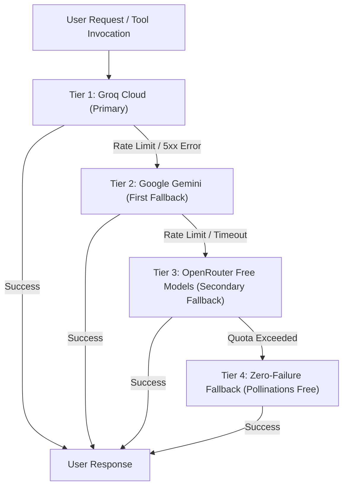

# Model Provider Specification & Cascading Fallback Hierarchy

## 1. Provider Tier Hierarchy

Airi Sensei v3.0 employs a 4-tier cascading model fallback system designed to achieve ultra-fast responses, massive context capacity, high tool-calling reliability, and zero service interruption.



---

## 2. Granular Tier Specifications

### Tier 1: Groq Cloud (Primary Inference & Tool Calling Engine)
- **Role:** High-speed primary execution loop.
- **Provider Ref in OpenClaw:** `groq/<model_slug>` or custom OpenAI-compatible endpoint.
- **Base URL:** `https://api.groq.com/openai/v1`
- **Authentication:** `GROQ_API_KEY`
- **Supported Models:**
  - `openai/gpt-oss-120b`: Flagship 120B mixture-of-experts model optimized for deep ReAct reasoning and complex function calling.
  - `openai/gpt-oss-20b`: Fast reasoning engine with minimal latency.
  - `qwen/qwen3.8-27b`: Strong multilingual (Vietnamese) reasoning.
  - `llama-3.3-70b-versatile`: Production-grade tool execution.
- **Tool Calling Support:** Native OpenAI-compatible tool calling with strict JSON parameter validation.
- **Performance:** Up to 500 tokens/sec LPU inference.
- **Timeout & Token Limits:** Timeout: 25.0s, max output tokens: 1,500.

### Tier 2: Google Gemini (First Fallback Engine)
- **Role:** Deep context reasoning and high-capacity fallback.
- **Provider Ref in OpenClaw:** `google/<model_slug>` or OpenAI-compatible endpoint.
- **Base URL:** `https://generativelanguage.googleapis.com/v1beta/openai/`
- **Authentication:** `GEMINI_API_KEY`
- **Supported Models:**
  - `gemini-3.5-flash`: Next-gen Flash model with native multimodal capabilities and fast reasoning.
  - `gemini-2.5-flash`: Production stable Flash model with 1M token context window.
  - `gemini-flash-latest`: Dynamic pointer to latest stable Flash tier.
- **Tool Calling Support:** Full support for function calling schemas and parallel function invocation.
- **Timeout & Token Limits:** Timeout: 30.0s, max output tokens: 1,500.

### Tier 3: OpenRouter Free Tier (Secondary Fallback Engine)
- **Role:** Resilient cost-free fallback across global open-weights models.
- **Provider Ref in OpenClaw:** `openrouter/<provider>/<model>`
- **Base URL:** `https://openrouter.ai/api/v1`
- **Authentication:** `OPENROUTER_API_KEY`
- **Supported Free Models:**
  - `google/gemma-4-31b-it:free`
  - `nvidia/nemotron-3.5-lightning:free`
  - `cohere/north-mini-code:free`
- **Tool Calling Support:** Supported on instruct-tuned variants.
- **Timeout & Token Limits:** Timeout: 35.0s, max output tokens: 1,500.

### Tier 4: Zero-Failure Fallback (Emergency Persona)
- **Role:** Ensures the bot always responds gracefully even under complete global upstream provider outages.
- **Provider Ref:** Pollinations AI / Text endpoint.
- **Base URL:** `https://text.pollinations.ai/openai`
- **Model:** `openai-fast`
- **Authentication:** None required (100% free, 0 API key).
- **Tool Calling Support:** None. Used strictly for plain conversational responses and safe fallback messaging.

---

## 3. OpenClaw Provider Configuration Schema

The mapping inside `openclaw.json` mirrors this structure:

```json5
{
  "agents": {
    "defaults": {
      "model": {
        "primary": "groq/openai/gpt-oss-120b",
        "fallbacks": [
          "google/gemini-2.5-flash",
          "openrouter/google/gemma-4-31b-it:free",
          "groq/openai/gpt-oss-20b"
        ]
      }
    }
  },
  "models": {
    "mode": "merge",
    "providers": {
      "groq": {
        "apiKey": "${GROQ_API_KEY}",
        "baseUrl": "https://api.groq.com/openai/v1"
      },
      "google": {
        "apiKey": "${GEMINI_API_KEY}",
        "baseUrl": "https://generativelanguage.googleapis.com/v1beta/openai/"
      },
      "openrouter": {
        "apiKey": "${OPENROUTER_API_KEY}",
        "baseUrl": "https://openrouter.ai/api/v1"
      }
    }
  }
}
```

---

## 4. Fallback Execution Mechanics

1. When a prompt is dispatched, OpenClaw attempts the `primary` model (`groq/openai/gpt-oss-120b`).
2. If Groq encounters rate limiting (HTTP 429), server failure (HTTP 5xx), or timeout (>25s), OpenClaw automatically falls back to `google/gemini-2.5-flash`.
3. If Google Gemini fails or is unreachable, the engine routes to `openrouter/google/gemma-4-31b-it:free`.
4. If all authenticated APIs fail, the runtime triggers emergency text fallback.
5. All transition events are logged with warning level for observability.
