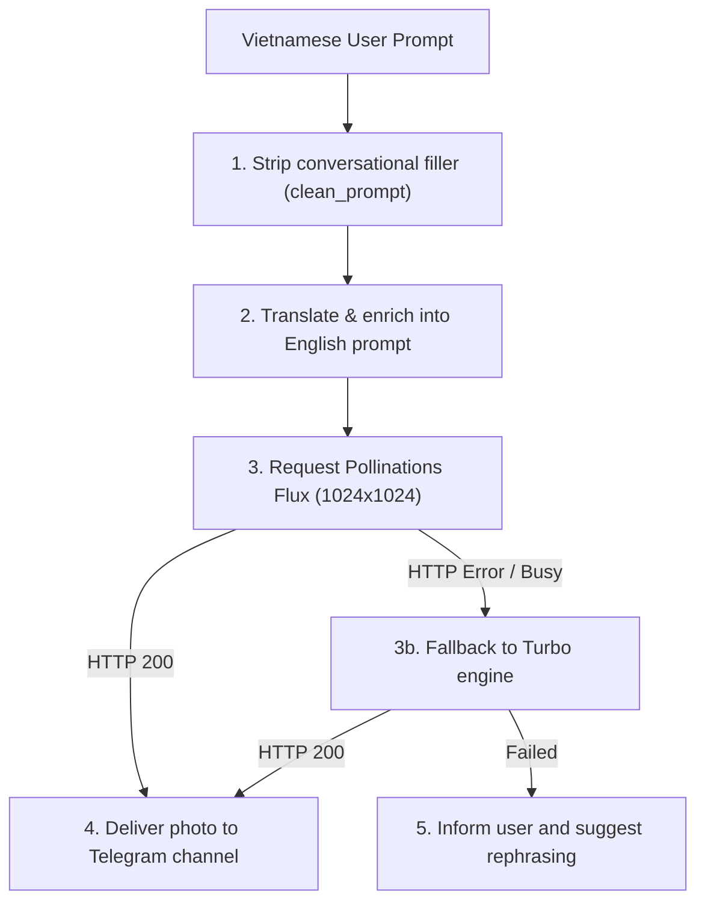

# Airi Image Generation Skill (`airi-image`)

## 1. Overview
This skill generates stunning 1024x1024 AI artworks from natural language descriptions. It automatically cleans Vietnamese request prefixes ("vẽ cho anh...", "tạo ảnh..."), translates and enriches the description into a vivid English prompt optimized for Flux / SDXL, and falls back to Turbo if Flux is under heavy load.

---

## 2. When to Use
- When the user explicitly sends `/image <prompt>` or `/taoanh <prompt>`.
- When the user asks Airi to paint, sketch, or generate an image in natural conversation:
  - *"Vẽ giúp mình một chú mèo phi hành gia ngoài vũ trụ anime 4k"*
  - *"Tạo ảnh hoàng hôn trên bờ biển Phú Quốc"*
  - *"Generate a cyberpunk samurai in neon Tokyo"*

Do NOT use for plain text questions, mathematical queries, or web searches.

---

## 3. Execution Workflow


---

## 4. Input Specifications
- **`prompt`** *(string, required)*: The description of the image the user wants to generate.
- **`model`** *(string, optional, default: "flux")*: Primary engine (`"flux"` or `"turbo"`).
- **`width`** *(integer, optional, default: 1024)*: Width in pixels.
- **`height`** *(integer, optional, default: 1024)*: Height in pixels.

---

## 5. Expected Output
- **Binary Image Buffer:** PNG/JPEG photo payload delivered directly to Telegram via `send_photo`.
- **Caption:** Formatted markdown caption showing the prompt and engine used:
  ```markdown
  🎨 **Tranh của bạn:**
  _A cute fluffy astronaut cat floating in starry cosmic nebula, anime key visual, highly detailed, 4k_

  *(Engine: flux)*
  ```

---

## 6. Error Handling & Fallbacks
1. If the Flux engine times out (>45s) or returns HTTP 5xx:
   - Immediately attempt fallback generation with the `turbo` engine.
2. If all engines fail:
   - Return a gentle, polite response:
     *"Ôi, các máy chủ vẽ tranh hiện đang bận một chút rồi anh ơi! Anh chờ một lát rồi nhắn lại em vẽ cho anh nhé! 🌸"*
