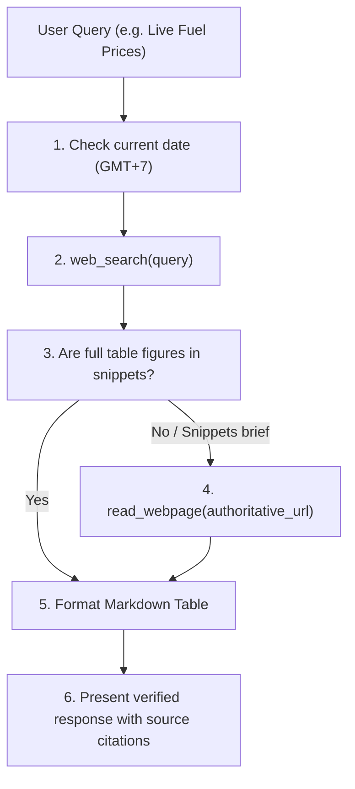

# Airi Research Skill (`research`)

## 1. Overview
The Research skill is Airi Sensei's primary instrument for verifiable truth. It prevents hallucination by executing a rigorous two-step research pipeline:
1. High-precision search via DuckDuckGo and Bing HTML engines.
2. Deep webpage extraction (`read_webpage`) to parse exact data tables, oil/gas prices, gold rates, weather reports, and financial news.

---

## 2. When to Use
- When asked about live, changing factual numbers:
  - *"Giá xăng hôm nay Petrolimex bao nhiêu?"*
  - *"Giá vàng SJC hôm nay tăng hay giảm?"*
  - *"Tỷ giá USD/VND Vietcombank hôm nay"*
  - *"Thời tiết Hà Nội tuần này"*
- When given a URL to read, analyze, and summarize:
  - *"Đọc bài viết https://... và tóm tắt 3 điểm cốt lõi"*

---

## 3. Mandatory Execution Doctrine

> [!CRITICAL]
> **No Guessing Allowed:** Never invent or estimate numerical values for live economic commodities (fuel, gold, currency). If a webpage cannot be accessed, report the exact error and cite what was found.

---

## 4. Input Specifications
- **`query`** *(string, required for search)*: Targeted search keywords.
- **`url`** *(string, required for webpage read)*: Direct HTTP/HTTPS link to fetch.
- **`max_results`** *(integer, optional, default: 4)*: Search result limit.
- **`max_chars`** *(integer, optional, default: 2500)*: Webpage extraction limit.

---

## 5. Expected Output Format
1. **Clear Direct Answer:** Summary of findings.
2. **Structured Markdown Table:**
   | Loại Hàng Hóa | Vùng 1 (VNĐ) | Vùng 2 (VNĐ) | Chênh Lệch |
   |---|---|---|---|
   | Xăng RON 95-III | 21,500 | 21,930 | -320 |
   | Xăng E5 RON 92 | 20,400 | 20,800 | -280 |
3. **Citations:** Direct clickable URLs used during research.

---

## 6. Error Handling
- If DuckDuckGo HTML engine fails: automatically fallback to Bing search.
- If target website blocks scrapers (HTTP 403/Cloudflare): report blocking gracefully and consult secondary search links.
